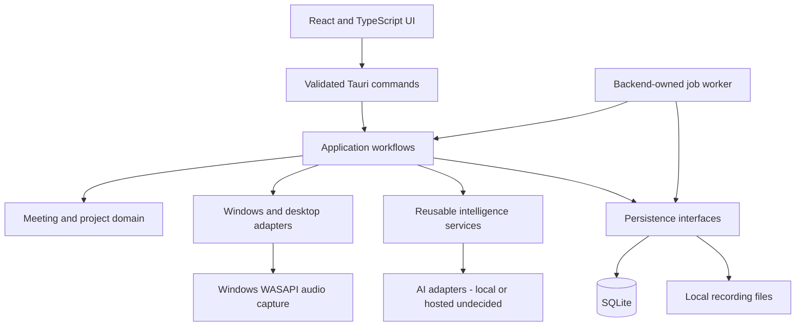

# Architecture Overview

Status: Proposed broader intelligence architecture, with implemented desktop, recording, transcription, and meeting intelligence foundations. See the implementation boundary below; future processing behavior is not implemented by this document.

## Requirements and decision labels

- **Confirmed requirement:** supplied by the project brief or existing README.
- **Proposed decision:** recommended design, pending review and validation.
- **Assumption:** planning premise that needs confirmation.
- **Future possibility:** optional direction outside the initial commitment.

The [product scope](PRODUCT_SCOPE.md) defines delivery boundaries. [ADR 0001](adr/0001-initial-architecture.md) explains the stack proposal; [ADR 0002](adr/0002-durable-meeting-processing.md) specifies the durable processing proposal. The ADRs describe intended intelligence processing behavior. The implemented foundation is described separately below.

## Goals and initial scope

**Confirmed requirements:** Build an independent, single-user Windows desktop application that records meetings, produces AI summaries and action items, organizes meetings into project folders, and answers questions across meetings. Reliable processing and recovery and folder-level question answering are MVP requirements. This is a learning project using professional software engineering practices. Potential future host integration must not require company infrastructure. The intelligence core must remain independent of the Windows shell.

**Proposed MVP:** User-controlled recording, persistent meeting records and transcripts, generated summaries and action items, project organization, and question answering within a selected project with traceable meeting evidence. Human review is necessary before treating generated output as reliable. Detailed scope and acceptance examples are in PRODUCT_SCOPE.md.

**Assumptions:** One Windows user profile owns a local workspace; a project folder is a logical grouping rather than necessarily an operating-system directory. Saved records are local, but AI processing locality is unresolved. Local persistence does not imply offline AI or that data never leaves the device.

## Proposed technology stack

| Layer | Proposal | Boundary or unresolved detail |
| --- | --- | --- |
| User interface | React and TypeScript | React/TypeScript with Vite and the approved custom UI are implemented. |
| Desktop host | Tauri with a Rust core | Tauri 2 and Rust are implemented; Rust owns Windows WASAPI capture. |
| Structured persistence | SQLite | Meetings/workspaces and recording metadata use Rust rusqlite repositories with migrations; Migration 0004 implements transcription jobs, checkpoints, and transcript provenance; Migration 0008 implements independent generation jobs, transcript evidence snapshots, structured result revisions, actions and attendee overrides; retrieval remains future work. |
| Recording storage | App-managed local files | Implemented: separate PCM16 48 kHz stereo WAV tracks in per-user local app storage, referenced by SQLite. Retention settings and backup policy remain undecided. |
| AI services | Provider-independent transcription and generation adapters | Implemented STT adapters: local whisper.cpp CLI and configured OpenAI-compatible remote transcription with per-recording upload approval. Generation now uses a separate configurable, authorized chat-completions adapter and durable Rust worker. |
| Retrieval | Project-scoped transcript retrieval | Evaluate lexical retrieval first; embeddings and vector storage are not selected. |
| Optional AI runtime | Python only if a selected engine needs it | No required Python service or sidecar in this proposal. |

Tauri uses a privileged core process and webviews; Windows rendering uses WebView2. Its Rust core is part of the desktop host, not evidence that all intelligence logic must be Rust. See the official [process model](https://v2.tauri.app/concept/process-model/). Language and runtime placement of reusable orchestration remain open; a TypeScript interface alone does not provide a backend runtime.

## Modules and responsibilities

These are logical modules in one desktop product, not independently deployed microservices.

| Module | Responsibility |
| --- | --- |
| Desktop UI | Recording controls, meeting/project views, output review, questions, progress, and actionable error feedback. |
| Desktop adapters | Windows audio/device access, app data paths, file operations, credential access, and Tauri command validation. Expose only necessary capabilities. |
| Application workflows | Coordinate recording finalization, processing, retries, project membership, and question requests through explicit use cases. |
| Meeting and project domain | Stable IDs, meeting metadata, logical project membership, transcript/output associations, and lifecycle rules. No dependency on Tauri or UI components. |
| Recording service | Coordinate capture through an audio adapter; finalize playable artifacts and report interruptions. Windows WASAPI capture is implemented; processing adapters remain independent. |
| Intelligence services | Independent transcription and generation adapters; summary, structured action/decision extraction, retrieval, and evidence-grounded answering. Avoid desktop path and widget dependencies. |
| Persistence adapters | SQLite repositories and recording-file storage; migrations, consistency checks, and artifact cleanup. |
| Jobs and diagnostics | Backend-owned worker, durable claims, stage checkpoints, bounded retries, recovery, safe status reporting, and idempotent persistence. Avoid sensitive transcript or credential logging. |

**Proposed separation:** Keep provider calls and secrets behind the privileged boundary, and keep the UI focused on presentation. IPC and provider responses need runtime validation; TypeScript compile-time checks do not validate external data. Domain and intelligence modules depend on contracts for repositories, AI capabilities, jobs, and artifact access, rather than the desktop shell. The concrete orchestration runtime must be chosen before implementation; do not assume Node.js ships with Tauri.

## Implemented recording foundation

Issue #3 implements Rust-owned microphone and Windows output loopback capture, endpoint selection and Windows format conversion, pause/resume with an active clock, separate timestamp-aligned WAV tracks, periodic synchronization, SQLite capture/track checkpoints, recoverable finalization, idempotent meeting registration, startup/manual recovery, and ID-scoped playback. UI navigation does not own capture; normal window close is blocked while active. Workspace deletion never deletes recordings. Detailed contracts, validation results, and limitations are in [Windows recording](WINDOWS_RECORDING.md).

The recording module itself does not own AI processing. Separate Rust modules now implement durable transcription and generation queues, validated transcripts and structured meeting intelligence; retrieval and automatic retention remain future work. Real recorded meetings begin with empty intelligence fields; independently authorized generation publishes versioned structured results without overwriting user metadata. Python remains optional. The proposed processing flow below describes the next integration boundary, not current execution.

## Recording to transcription and summarization

1. Register a capture identity and persist audio progressively to app-managed partial files with bounded buffering and periodic synchronization. Source support, file format, synchronization interval, and acceptable crash-loss window remain open.
2. Stop waits for writers to close, validates available tracks, and finalizes files through a recoverable marker/rename protocol. Once durable files exist, atomically register their finalized metadata and one queued processing job in SQLite. Filesystem operations are outside the transaction; recovery reconciles the gap without deleting originals or guessing that partial audio is complete.
3. A backend-owned worker claims jobs independently of React components and UI connections. Durable ownership tokens and an OS lock or validated equivalent prevent overlapping execution. UI closure does not cancel jobs; full process exit pauses execution until restart unless an independent service is later chosen.
4. Transcription runs through its own adapter. Persist validated segments with stable IDs, transcript revision, source artifact/track references, language, and optional start/end timestamps. Never invent unavailable timestamps or infer verified speaker identities from tracks.
5. Generation runs through a separate adapter. Validate summaries, structured action items, and decisions, including source evidence references, before checkpointing. Missing owners/deadlines remain null. Use explicit chunking/coverage reporting for long input rather than silent omission.
6. Matching stage checkpoints permit later-stage retries without repeating successful AI calls. Commit completed meeting artifacts, recording association, and result receipt in one transaction with a unique operation identity. A transcript revision invalidates dependent generation and retrieval data.
7. UI reads durable state through status queries/events and loads persisted results. Indexing is derived work: a durable rebuild marker recorded with result persistence permits recovery without holding a database transaction across AI calls.

**Proposed job behavior:** States are `queued`, `processing`, `retry_wait`, `succeeded`, `failed`, `cancelled`, and `recovery_required`. Stages are `transcription`, `generation`, and `persistence`; retrieval indexing and retention maintenance are separate recoverable tasks. Retry transient errors with bounded backoff and stage-specific budgets; configuration/authentication failures require correction. Startup recovers stale ownership only when no live execution owns the lock. Ambiguous outcomes require reconciliation rather than blind repetition. Exact retry limits, deadlines, concurrency, cancellation protocol, and locking mechanism remain open. A local worker is proposed; no external queue or mandatory Python runtime is selected.

**Proposed retention:** Processing success does not itself authorize audio deletion. Configurable policy governs retention after a known committed result and any required preservation period. Failed, interrupted, or recovery-required work retains source audio unless the user explicitly discards it through a safe operation. Retention duration, default, storage-pressure behavior, and override UX remain undecided. Audio deletion preserves transcript citations but disables playback with a clear unavailable indication; full meeting deletion removes or invalidates its derived retrieval data.

## Project-folder question answering

**Proposed flow:** Resolve project membership before retrieval and enforce it when reading passages. Retrieve from persisted transcripts, with meeting IDs, transcript revisions, and passage locations. Summaries can assist navigation but should not replace original evidence. Bound the context to model limits, ask for an evidence-grounded answer, and return insufficient-evidence feedback when relevant material is absent. Validate that cited IDs exist in the supplied evidence; this alone cannot establish semantic correctness.

Indexes are derived data and must reflect transcript edits, meeting deletion, and project reassignment. Source links should navigate to a transcript passage, and to audio timestamps only when available. Treat transcript text as untrusted content rather than instructions to execute tools. Retrieval method, ranking, chunking, citation precision, and answer-history persistence remain open. Start with a representative evaluation set before choosing embeddings or a vector database.

## Persistence and privacy boundaries

**Proposed entities:** Project, Meeting, RecordingArtifact, Transcript/Segment, GeneratedOutput, ActionItem, Decision, ProcessingJob, StageAttempt, StageCheckpoint, ResultReceipt, and source/provenance references. Evidence identifies meeting, transcript revision, segment/span, and available timestamps. Action items carry stable IDs, text, nullable owner/deadline, and evidence; decisions carry stable IDs, text, and evidence. This is a conceptual model, not a finalized schema. Extracted facts initially belong to their meeting; task management and cross-meeting decision evolution are separate capabilities.

Store large audio artifacts separately from SQLite and access them through app-owned identifiers. Backups must capture database and referenced artifacts consistently. The MVP should expose failures clearly and retain usable recordings when processing fails. Encryption at rest, deletion/retention behavior, backup/export, and credential storage mechanisms must be resolved before processing real sensitive meetings. Do not store secrets in UI bundles, source control, or ordinary meeting rows.

## Future integration boundaries

**Future possibilities:** A future host could call reusable meeting-processing or project-question use cases through an in-process adapter or versioned API; the transport is not selected. Exchange stable meeting/project IDs, transcript segments, generated outputs, provenance, and structured errors through explicit contracts. Host-specific identifiers should be mapped by integration adapters.

Keep Windows capture, desktop UI, local paths, identity, credentials, and SQLite access behind adapters. A future host may supply different identity, storage, or AI providers without changing the core use-case contracts. Multi-user authorization, tenant isolation, synchronization, and remote job execution would require new architectural decisions; single-user project filtering is not a multi-tenant security design.

No company repositories, infrastructure, credentials, endpoints, source code, prompts, or assets are required or included. Integration contracts can be explored using synthetic data in this independent repository.

## Implemented desktop widget boundary

One independent native Tauri widget window is managed by a Rust coordinator and observes the existing recording service. Main and widget controls share recording identity/state; Rust serializes and latches Stop requests across webviews. Widget visibility, drag behavior, main-window restoration, and optional detection belong to desktop adapters, separate from reusable intelligence services. Normal app exit remains blocked during capture/finalization.

Optional local meeting detection is off by default; only its boolean preference is persisted in SQLite migration 0003. The five-second scanner combines supported process/window identification with existing WASAPI microphone-session activity where available, using an explicit Zoom call-window fallback. It never opens an audio stream or confirms meeting attendance. Suggestions require user action and always open recording setup. Observations and suppression keys remain transient. See [Desktop widget and detection](DESKTOP_WIDGET.md) for implemented signals, false-positive/false-negative limitations, and tested behavior.

## Implemented local transcription slice

The existing finalization transaction now registers a unique SQLite transcription job. A backend-owned single worker with an exclusive OS lock, transactional ownership, bounded retries, per-source chunk checkpoints, and atomic transcript/result receipts processes finalized WAVs independently of the UI lifecycle. Local runtime/model configuration is explicit; an optional remote transcription adapter now requires revision-specific upload approval, as described below. Original audio and capture safeguards remain intact. [ADR 0003](adr/0003-local-transcription-queue.md) and [TRANSCRIPTION.md](TRANSCRIPTION.md) document the implemented contracts and limitations; generation, structured intelligence, and retrieval remain proposed.

## Configurable AI settings

Transcription provider settings and future summarization settings are separate versioned contracts. Non-secret settings are stored in SQLite, and Windows Credential Manager owns API keys. Started jobs freeze their provider snapshot; remote work additionally requires current revision-specific upload approval, issued at finalization under the saved automatic preference or through an explicit manual action. Explicit rebinding clears incompatible partial checkpoints without changing recordings or completed transcripts. Nullable timestamps preserve remote-provider limitations. [AI_PROVIDERS.md](AI_PROVIDERS.md) describes security, consent, tests, and gateway compatibility.

Automatic transcription uses the existing finalization transaction and worker: migration 0007 persists a reviewed provider revision, a capture eligibility watermark, and a ready flag. New eligible captures receive authorization when saved; older/backfilled captures stay manual. Meeting detail/status reads never start work. Provider changes require renewed preference review; existing checkpoint, retry, and result receipts remain authoritative.

## Implemented meeting intelligence

[AI_MEETING_INTELLIGENCE.md](AI_MEETING_INTELLIGENCE.md) and [ADR 0004](adr/0004-meeting-intelligence.md) document the generation implementation and exact limits. Successful transcription atomically registers an immutable evidence snapshot and eligible generation job. A separate Rust worker claims generation work, checks provider-bound transcript-sharing authorization, checkpoints bounded extraction/synthesis, and atomically publishes structured result revisions. Retry/regeneration never invoke transcription. React reads persisted states/results independently of navigation. Suggested titles do not replace user titles; unknown identities/deadlines are not filled from UI placeholders. Minutes are deterministic presentation, not another provider call. Existing broader retrieval and retention proposals below remain future design.
