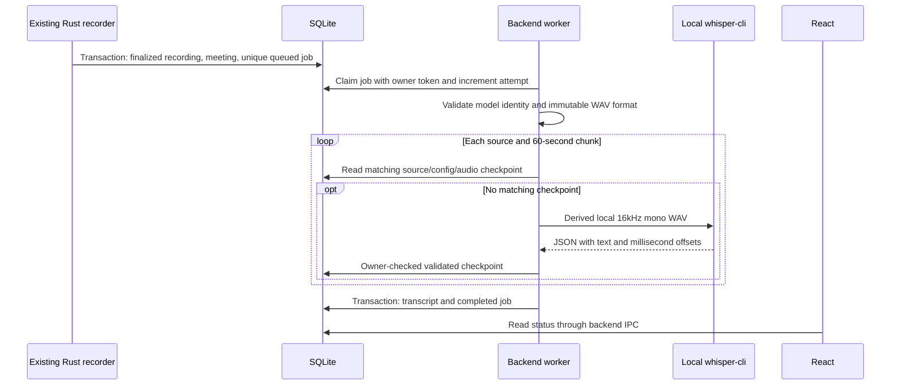

# Local transcription and durable jobs

Implemented for the transcription-only pipeline. Configurable remote providers and secure AI settings are now documented in [AI_PROVIDERS.md](AI_PROVIDERS.md). Summaries, decisions, action items, and workspace question answering remain future features. The actual model/provider used by the reference applications is **unverified in this repository**; no reference application source or configuration was inspected.

## Provider and setup

The real adapter runs the public [whisper.cpp CLI](https://github.com/ggml-org/whisper.cpp) locally. The Windows x64 CPU release **v1.8.3** and multilingual **Whisper tiny GGML** model were used for the known-audio feasibility test. A multilingual **base** GGML model is the recommended starting configuration for improved accuracy; it has not been quality-benchmarked here. English-only `.en` models do not support Arabic. No Python runtime, network AI service, API key, GPU, or global package installation is required. CPU inference uses four threads, with GPU use disabled.

1. Obtain a trusted Windows CPU runtime from the [official releases](https://github.com/ggml-org/whisper.cpp/releases/tag/v1.8.3). Keep `whisper-cli.exe` with its shipped DLLs; install the Microsoft runtime required by that distribution if necessary.
2. Obtain a compatible GGML model from the [upstream model instructions](https://github.com/ggml-org/whisper.cpp/tree/v1.8.3/models). Keep large binaries outside the repository. Model download is a separate inbound transfer; no meeting audio is uploaded.
3. In the app, open the gear button → Recording preferences → AI Processing → Transcription → Local Whisper. Enter absolute local paths and `auto`, `en`, `ar`, or another supported two-letter language code. Saving authorizes execution of the selected local program. Unsupported language/model combinations fail visibly.
4. Save configuration. Configuration-blocked jobs are requeued while within their lifetime attempt budget; other failed jobs have a Retry transcription action in meeting details.

The application neither downloads nor bundles this runtime/model. Their versions, provenance, disk space, DLLs, CPU instruction compatibility, and model quality remain deployment responsibilities. SHA-256 fingerprints record the explicitly configured executable/model identity, not a publisher signature. Changed files require saving configuration again. Configure only files you trust. The optional remote adapter requires explicit per-recording upload approval; see AI_PROVIDERS.md. Local mode still has no fallback upload.

## Durable contracts and lifecycle

Migration 0004 adds `processing_jobs`, `transcription_checkpoints`, `transcripts`, and a singleton `transcription_settings` row. The existing recording finalization transaction registers the meeting, track metadata, and a unique job for that recording. Duplicate finalization cannot create another job. Startup also backfills finalized recordings with live meeting associations, including previously saved recordings.



States are `queued → processing → completed`, or `processing → retryable → processing`, or `processing → failed`. Stages expose validation and the current source/chunk. Status includes job/meeting/recording IDs, attempt count, safe error category/message, creation/update/start/completion times, retry due time, and checkpoint count. No percentage is invented. Completed segments are fetched only for the open meeting, keeping routine card polling lightweight.

One backend thread scans SQLite every 500 ms and processes one job at a time. It survives main-window navigation/minimization but stops with the application process. A Windows-compatible exclusive file lock prevents a second live worker from reclaiming jobs. Claim transactions are short; no database transaction stays open during inference. Claims/checkpoints/results verify an owner token. Stale owners and deleted meetings cannot commit results. Job deletion cascades to derived transcripts/checkpoints, while existing recording/audio retention behavior is preserved. Workspace deletion only changes meeting assignment.

On startup, after acquiring the lock, interrupted `processing` jobs become `retryable` if fewer than three attempts were consumed, otherwise `failed`. Durable checkpoints remain. Retryable provider/storage/interruption failures use 20/40-second backoff within three automatic attempts. Manual retry allows at most five lifetime attempts, never resets counters, and is unavailable for active/completed jobs. Configuration and invalid-input/output failures require correction rather than automatic retry. Configuration updates invalidate mismatched checkpoints on retry; completed transcripts are not silently regenerated. There are no nested adapter retries.

Windows child processes are hidden and assigned to a kill-on-close Job Object. Graceful worker cancellation, a ten-minute per-chunk deadline, failures, and process exit terminate the child. If worker initialization/storage fails, the UI exposes a worker error and restart is the recovery entry point. Processing does not continue after full app exit.

## Audio, checkpoints, and transcript traceability

Capture retains separate 48kHz stereo PCM16 WAVs: `recordings/<recording UUID>/microphone.wav` and/or `system.wav` in per-user local app storage. Recovered sources use `.recovered.wav`. Both sources share the existing capture timeline, silence padding, and pause exclusions. Transcription never joins tracks end-to-end or modifies them.

The adapter validates the canonical finalized WAV header, payload length, and SQLite frame count. It reads at most 60 seconds per source, averaging each group of three stereo frames into one 16kHz mono sample. This bounded box filter is deliberately simple; higher-quality resampling is a follow-up. Derived audio/JSON lives only in a dedicated local scratch directory, removed after the job attempt; a hard crash can leave scratch for the next attempt to overwrite/remove. Source audio is never deleted by processing.

Each checkpoint is keyed by job/source/chunk and a SHA-256 fingerprint of the chunk PCM, executable/model digests, language, and pipeline version. It includes validated text and millisecond source offsets. Validity is checked again on reuse. A transcription segment has `text`, `start_ms`, `end_ms`, and source references with track role and original timestamp range; its transcript/job row supplies the source recording and meeting identity. Track attribution does not identify a speaker.

Results are sorted on the common timeline. Equal normalized text from different tracks whose start/end times are within two seconds is displayed once, with both source references retained. Different text/uncertain echoes and simultaneous speakers remain separate. This is conservative duplicate reduction, not echo cancellation or guaranteed deduplication. Chunk boundaries can split words/context and matching real repeated utterances can be collapsed. Further overlap/context handling requires quality testing.

Digital-zero silence checkpoints as an empty result without invoking inference. Other quiet/noisy audio uses Whisper's speech recognition behavior; hallucinations and missed speech remain possible. Empty recognition is displayed explicitly, not replaced by fabricated text. Malformed JSON, invalid timestamps, missing/corrupt WAVs, missing models, timeouts, and runtime failures become visible errors. Recovered/discontinuous recordings carry an incomplete-coverage warning. No summary or speaker identity is generated.

The validated full transcript and `completed` state commit in one SQLite transaction, acting as the idempotent result receipt. Partial checkpoints are not displayed as a complete transcript. Original recordings remain playable across failure, retry, and restart. Retention policy remains unchanged: this feature does not automatically expire/delete originals. Local database, transcripts, runtime paths, and scratch are private files but are not encrypted by this feature.

## Validation

Run:

```powershell
npm.cmd run typecheck
npm.cmd run build
node --experimental-strip-types --test tests/recording-flow.test.mjs
cargo fmt --manifest-path src-tauri/Cargo.toml -- --check
cargo check --manifest-path src-tauri/Cargo.toml --locked
cargo test --manifest-path src-tauri/Cargo.toml --lib --locked
```

The opt-in real test requires `MIW_TEST_CLI`, `MIW_TEST_MODEL`, and `MIW_TEST_AUDIO` absolute paths. The audio fixture must be canonical 48kHz stereo PCM16 WAV containing the public JFK sample. Run `cargo test --manifest-path src-tauri/Cargo.toml --lib real_local_transcription_and_restart_checkpoint_reuse -- --ignored`. It checks recognizable text, persistent timestamps/results, retained source audio, and recovery using a real saved checkpoint. Default tests require no model/download or external process.

Debug builds additionally accept `MIW_DEV_DATA_DIR` as an absolute isolated test root (`data` and `local` children). This permits desktop restart validation with public fixtures without changing the normal user profile. Release builds ignore it and always use Tauri's per-user data paths. Test models, samples, private databases, transcripts, and build outputs must remain outside tracked files; `target/` is ignored.

Known limits requiring further validation: Arabic/multilingual accuracy, long meetings, noisy/quiet speech, resampling quality, chunk-boundary losses, echo reduction, device-failure/recovered-source coverage, runtime packaging on other Windows CPUs, live process termination during child creation, and storage failure injection. No claim of parity with the reference products or universal transcription accuracy is made.

### Results for this change

- TypeScript, production build, locked Rust checks, formatting, and Git whitespace checks passed.
- 40 standard Rust tests and 7 existing frontend recording-flow tests passed. The additional opt-in real test passed separately with whisper.cpp v1.8.3 and multilingual tiny on CPU. It transcribed the public JFK sample on both source tracks, retained both source references after duplicate reduction, and reused durable checkpoints after interrupted-result reconciliation.
- A native Windows debug launch used an isolated public-audio profile. Its backend produced a timestamped transcript across two chunks; the meeting and transcript remained available after desktop shutdown/relaunch. The Home status and Transcript detail tab displayed the persisted result. Original audio remained accessible. Test-only profiles/models/samples are under ignored build storage; the normal user profile was not configured with the test provider.
- Missing configuration, corrupt WAVs, digital silence, competing worker locks, duplicate registration, bounded automatic/manual retries, stale ownership, and atomic completion rollback are covered by automated tests. OS-level crash/device removal, full-disk failures, long-meeting throughput, Arabic accuracy, and installation on a clean Windows machine remain manual checks. Interrupted-result recovery was simulated in a real-provider test; a forced OS crash was not performed.

The public sample visibly split a phrase at the 60-second boundary; this is an observed limitation, not a claimed seamless long-meeting transcript. The native test processes were stopped after validation.
