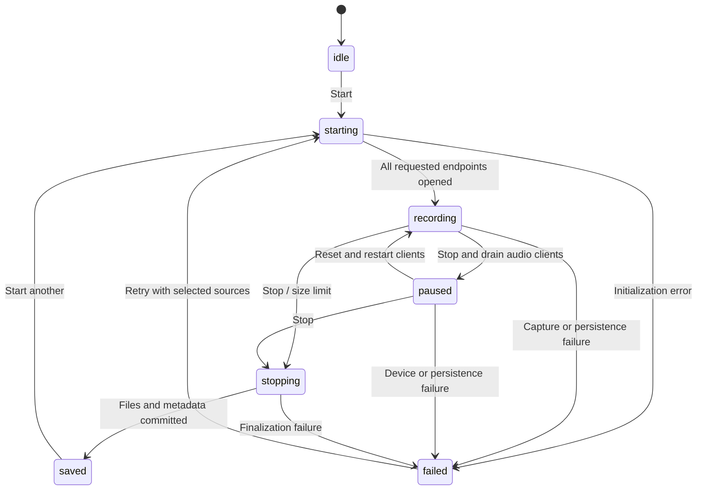
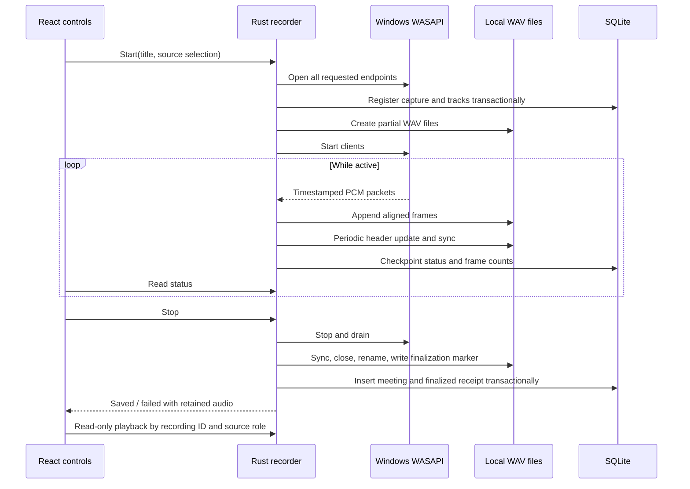

# Windows recording implementation

Status: Implemented for Issue #3. AI processing and the durable processing queue remain proposals. This implementation was independently developed against public Windows and Tauri APIs.

## Capture and lifecycle

Rust owns one recording worker, its WASAPI clients, clock, and file writers. React invokes validated start/control commands and polls status every 250 ms; hiding a dialog, navigating, or reloading the webview does not own capture. The normal window close operation is blocked during `starting`, `recording`, `paused`, and `stopping`. Forced process termination remains possible and invokes recovery on the next launch.

The backend uses shared-mode WASAPI with Windows sample-rate/channel conversion to 48 kHz stereo PCM16. Users can select active input and output endpoints or the defaults resolved at start. All requested endpoints must open before capture starts; a loopback failure does not cause microphone-only fallback. An endpoint is pinned for the session; unplugging it or invalidating it stops capture with an explicit error and preserves available files.

Microphone and system audio remain **separate WAV tracks**. Each packet is placed on a common QPC timestamp timeline: gaps become silence and overlapping frames are trimmed. Both tracks are padded/truncated to the same active duration on successful stop. Pause stops/drains both clients, freezes duration, and resets them before resuming with a new clock epoch. Paused intervals are excluded. This is timestamp alignment, not a claim of sample-perfect synchronization between hardware clocks. No audio mixing, echo cancellation, or inferred speaker identification is implemented. The decorative waveform is a UI animation; its opacity indicates the current observed peak, not a stored waveform analysis.

See Microsoft's [loopback capture](https://learn.microsoft.com/en-us/windows/win32/coreaudio/loopback-recording) and [capture buffer/timestamp contract](https://learn.microsoft.com/en-us/windows/win32/api/audioclient/nf-audioclient-iaudiocaptureclient-getbuffer).

## Files, consistency, and recovery

- SQLite migration `0002.sql` adds `recordings` and `recording_tracks`. Audio is never stored as a database blob. The database remains in Tauri's per-user `app_data_dir()`; audio is in `app_local_data_dir()/recordings/<UUID>/` (normally `%LOCALAPPDATA%/dev.meetingintelligence.workspace/recordings`). Never resolve these directories from a hard-coded username.
- A process-held exclusive `recorder.lock` prevents another instance from recording or recovering the same storage. It is an OS file lock, not a stale-file existence check; Windows releases it on process exit. This coordinates capture and recovery, not all meeting CRUD operations.
- Register the capture identity and requested tracks transactionally before writing capture payload. Create new `microphone.wav.part` and/or `system.wav.part` files with WAV headers. Write each captured packet progressively; update headers, synchronize files, and checkpoint metadata approximately once per second. There is no whole-recording RAM buffer.
- Stop drains clients, closes/synchronizes writers, and renames tracks to `.wav`. Then synchronize a JSON finalization marker through a temporary file and rename. Finally, one SQLite transaction inserts the meeting and updates finalized metadata and its receipt. Meeting notes start empty; saving does not fabricate summaries, tasks, or transcripts.
- Filesystem renames and SQLite commits cannot share a transaction. Startup, or the explicit recovery control while capture is inactive, reconciles unfinalized rows. A validated marker repairs a lost database commit without creating duplicate meetings. Without a marker, derive payload length from the actual file, ignore stale header lengths, drop only an incomplete final frame, and write `.recovered.wav` through a retryable scratch copy. Keep original partial files and label the result incomplete. Recovery never guesses that an interrupted recording was complete.
- The finalized receipt remains set if the meeting is deleted; recovery never recreates intentionally deleted notes. Workspace deletion only unassigns meetings. Meeting deletion retains recording metadata with a nullable meeting relationship and retains files; these appear in Note Taker's retained recording section.
- Failed reconciliation retains metadata and files, reports a warning, and is retried at next startup or manually. There is no automatic restart of capture after failure and no processing queue yet.

Successful playback uses a custom, read-only `recording` URI protocol. It resolves a validated UUID and source role through SQLite, checks canonical path containment, permits only app origins, and serves bounded byte ranges. React cannot provide arbitrary filesystem paths. WAV requests without a range are limited to 8 MiB; WebView2 playback uses range requests capped at 2 MiB per response. Missing files display a playback error rather than silently disappearing.

## Future processing boundary

A finalized recording exposes stable recording/meeting IDs, track role and device identity, relative file reference, format, frame count, active duration, and `complete`/`recovered`/warning flags. The future application workflow can create a unique durable transcription job in the same finalization transaction as metadata; **no job is created today**. Intelligence adapters should request artifacts by ID, not depend on WASAPI or React. Incomplete recordings require review before future processing. Provider, transcription runtime (including optional Python), queue schema, and retry budgets remain unresolved.

## Limitations and retention

- Desktop microphone permission, active Windows Audio services, supported shared-mode conversion, and device availability are required. Protected/DRM or exclusive audio may be unavailable. System loopback records the entire selected playback endpoint, not one meeting app; idle endpoints can yield silence. Capture does not route another application's audio to a different endpoint.
- Only Windows capture is implemented. Other platforms return an explicit unsupported error. No hot-swap, per-app loopback, Bluetooth profile management, compressed recording, or continuous drift resampling is implemented. Different device formats are converted by Windows; unsupported conversion fails explicitly.
- Four active hours maximum per recording, safely below WAV's RIFF size limit. PCM16 stereo uses about 192 kB/s per track (roughly 691 MB/hour per source). Recovery may temporarily require another full track's disk space. Disk-full/permission errors preserve what was written but cannot guarantee playable recovery if headers/storage are damaged.
- File writes and metadata checkpoints run on the capture worker. Disk/database stalls can exceed the Windows capture buffer and cause a reported discontinuity; stress testing is still required. Capture is not a hard real-time service.
- Periodic file synchronization reduces the crash-loss window; it cannot guarantee survival of every frame during power failure, hardware failure, or OS buffering. An interrupted silent loopback's recovered duration may be shorter than the last displayed duration because no packets existed to persist silence before stop. Review recovered sources.
- Files are retained indefinitely in this issue. There is no automatic deletion, encryption at rest, export, or retention settings implementation. Configurable retention, backup consistency, storage-pressure UX, and abandoned metadata cleanup need a later decision. Failed/recovered sources and originals are never automatically deleted.

## Validation

Automated tests use synthetic PCM and isolated temporary SQLite databases. They cover lifecycle guards, pause timeline arithmetic, gap/overlap handling, stale headers and incomplete frames, retrying interrupted recovery copies, finalization-marker/database gaps, idempotent registration, ownership locks, relationship preservation, missing audio, and read-only/range playback checks.

Final checks: TypeScript, production Vite build, Rust compilation with the lockfile, Rust formatting, and all 21 library tests passed. Initial restricted-sandbox builds failed with Windows filesystem access errors; the same checks passed outside that sandbox. The unavailable-source test requests a deliberately nonexistent output endpoint and verifies failure without an alternate recording. Private WAVs, partial/recovery files, recording markers, local databases, environment files, and build output are excluded from Git. Native test processes and the Vite server were stopped afterward.

Native Windows Tauri verification on October 11, 2026:

| Check | Observed result |
| --- | --- |
| Microphone + default-output loopback | Both opened and recorded; separate WAVs had equal frame counts and 41.910 seconds of active duration. Microphone payload contained nonzero samples. Idle output produced expected silence. |
| Pause/resume | Paused timer remained at 10 seconds; resume continued the active clock and finalized both tracks. |
| Dialog/navigation lifecycle | Closing controls and moving to Note Taker continued the same capture; reopening controls showed the ongoing duration. Normal window close during pause was blocked. |
| Save and restart | Saved meeting appeared in Home after a native process restart; both 48 kHz stereo PCM16 WAVs decoded and playback timers advanced. |
| Real interrupted capture | System-only capture recorded two synthetic output tones, then the verified test executable was force-stopped. Startup created one recovered meeting and playable 14.816-second WAV, showed an incomplete warning, retained the original `.part`, and produced a header matching payload length. Recovered audio had nonzero samples. |

The tests observed decoding/playback progression and analyzed only aggregate PCM statistics; audible speech quality and long-term synchronization still require human listening. Remaining manual tests: USB/Bluetooth and alternate sample-rate devices, unplug/disable/exclusive/permission failures, sleep/resume, long recordings and seeking beyond initial range chunks, disk-full/write failures, and real power-loss behavior. Do not infer compatibility with every Windows audio device from this single machine. Installer bundling remains disabled; packaged release validation is still needed.

## Files changed for Issue #3

New files:

- `src-tauri/migrations/0002.sql`
- `src-tauri/src/recording/mod.rs`, `service.rs`, `windows.rs`, `wav.rs`, `playback.rs`, `tests.rs`
- `src/data/recording.ts`
- `src/components/RecordingPanel.tsx`, `RecordingPlayback.tsx`
- `docs/WINDOWS_RECORDING.md`

Updated files:

- `src-tauri/Cargo.toml`, `Cargo.lock`, `tauri.conf.json`
- `src-tauri/src/lib.rs`, `storage.rs`, `storage/tests.rs`
- `src/app/App.tsx`, `src/components/DemoDialogs.tsx`
- `src/data/repository.ts`, `simulation.ts`, `types.ts`, `useLocalData.ts`
- `src/pages/HomePage.tsx`, `MeetingDetail.tsx`, `NoteTakerPage.tsx`
- `src/styles/global.css`
- `.gitignore`, `README.md`, `docs/ARCHITECTURE.md`, `docs/LOCAL_DATA.md`

## Recording UI flow

New Recording is a fresh, dialog-local form: empty title, 00:00, collapsed Audio Settings, and one Start Recording action. The Rust session remains separate; reopening while capture is active restores its controls and timer. Device refresh retains explicit choices; unavailable requested sources block starting. System audio is enabled only by selection (or as the available default when there is no microphone), and is never substituted silently.

Stop & Save waits for the worker's saved status and a successful SQLite snapshot refresh before returning to the main Note Taker library. A failed finalization stays in a retained-audio recovery state; a failed list refresh offers retry without recording again. Interrupted-recording recovery is contextual; saved playback stays in meeting details and retained recordings in Note Taker. No backend capture/storage behavior was changed for this refinement.

Run `node --experimental-strip-types --test tests/recording-flow.test.mjs` for frontend session isolation and recovery classification tests. Native UI checks must additionally cover consecutive saves, navigation, unavailable devices, and storage-failure recovery.

### UI refinement validation (2026-10-11)

- Passed seven frontend flow tests: stale-session isolation, active navigation, retained failure state, consecutive sessions, recovery classification, missing requested devices, and save/refresh navigation gating.
- Passed TypeScript, production build, Rust check, formatting check, and all 21 Rust recording/storage tests.
- Native Windows checks: reopening an abandoned draft cleared title and timer; both-source capture survived navigation and reopening controls; two consecutive recordings saved directly to Note Taker and appeared immediately; Pause/Resume remained functional; reopening after a warning-bearing saved session had no stale warning/title/timer; explicit microphone selection survived device refresh.
- The existing Windows discontinuity warning appeared after resume and remained visible. No capture backend changes were made.
- Actual disk-full/permission-denied save failures and live device unplugging were not induced in the user's data directory. Failure navigation and unavailable-device behavior were covered with automated flow tests; existing Rust recovery tests passed. These destructive/environmental scenarios remain manual integration checks.
- A fresh desktop launch attempt reported port 1420 already in use. Native checks used the existing running development app with the updated frontend; it was left idle on Note Taker. Two local test meetings/audio recordings were retained, outside Git.
