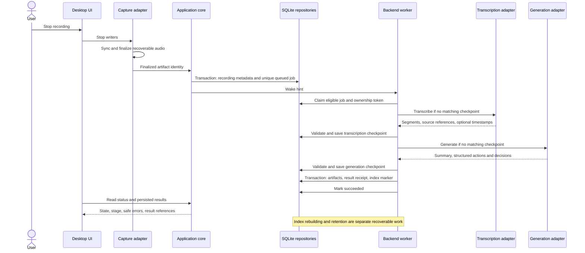

# ADR 0002: Durable Meeting Processing

Status: Proposed — awaiting review and feasibility tests.

This independently authored design uses general durability and background-processing patterns. It describes proposed behavior for Meeting Intelligence Workspace, not verified implementation. No reference repository was accessed for this task. [ADR 0001](0001-initial-architecture.md) remains the stack proposal; the [architecture overview](../ARCHITECTURE.md) and [product scope](../PRODUCT_SCOPE.md) define module and product boundaries.

## Context and problem

**Confirmed requirements:** Reliable processing and recovery, folder-level AI question answering, and an intelligence core independent of the Windows shell belong to the MVP. Summaries and action items must be useful across saved meetings; structured decisions and traceable transcripts support later decision evolution and timelines.

Slow or failed AI requests, UI closure, crashes, duplicate requests, and interrupted file/database writes must not silently lose recordings or duplicate results. Audio files, database transactions, and remote provider calls cannot share one atomic transaction. A completed summary does not establish that every stage, index, or retention action completed.

**Assumptions:** One local workspace and user; SQLite and app-managed recording files as proposed in ADR 0001. No external queue, always-running Windows service, provider, model, or AI runtime is selected. Python remains optional until engine requirements are evaluated.

## Proposed pipeline

1. Register a capture ID and persist selected audio streams progressively to private partial artifacts with bounded memory use.
2. Stop and close writers; validate source files; finalize using synchronized files and recoverable completion metadata. Preserve originals when recovery needs repair.
3. In one database transaction, register finalized artifact metadata and an idempotent queued job. The recording identity originates at capture registration, so recovery can reconnect files and rows.
4. A backend-owned worker claims eligible jobs. It invokes independent transcription and generation adapters and persists validated stage checkpoints.
5. Commit completed artifacts, their recording association, a result receipt, and an index-rebuild marker atomically. Derived indexing then makes the meeting eligible for project retrieval.
6. Expose durable status and result references to the UI. Apply retention separately under an explicit configured policy.

The wake hint is an optimization; durable scanning must discover work after a missed notification or restart. UI events do not own job execution. A worker hosted in the application backend remains alive through UI unmounting, but exits with the process. Continuous processing after full application exit would require a separately approved service/lifecycle design.

## Job states and stage transitions

| State | Meaning and eligible transition |
| --- | --- |
| `queued` | Ready for claim; becomes `processing` or safely `cancelled`. |
| `processing` | Owned execution; succeeds, waits to retry, fails, or requires recovery. |
| `retry_wait` | Retryable failure with durable due time; becomes `processing` when eligible or `queued` through allowed manual retry. |
| `succeeded` | Known result receipt committed; indexing/retention status is reported separately. |
| `failed` | Permanent error or exhausted budget; correction and an explicit permitted retry may return it to `queued`. |
| `cancelled` | Confirmed cooperative stop before final result commit; not implicit permission to delete audio. |
| `recovery_required` | Missing/invalid artifacts or an ambiguous outcome needing reconciliation; no blind retry. |

The processing stages are `transcription → generation → persistence`. Checkpoint reuse skips completed stages. Capture finalization precedes processing; indexing and retention are separate tasks. Store attempts with stage, start/end times, outcome, error category, and durable retry eligibility. State/status history should remain understandable after restart.

**Proposed ownership:** Use transactional claims with unique ownership tokens, expiry/heartbeat, and an OS execution lock or equivalent mechanism validated on Windows. All state writes and result commits verify current ownership. Expiry alone cannot override a live lock. Shutdown/cancellation must stop execution cooperatively before releasing ownership; cancellation racing with a committed result reports the saved result instead of deleting it. Exact lock mechanism and cancellation UX remain unresolved.

## Failure and retry policy

- Transient connection failures, throttling, and retryable provider errors use bounded exponential backoff with jitter; respect provider retry guidance where available.
- Authentication, invalid configuration, invalid input, and malformed output are distinct typed categories. Do not infer permanent/transient status by parsing exception text. Limited output-repair attempts may be considered, but must consume a defined generation budget.
- Persist separate transcription and generation attempt counters/budgets. A generation failure reuses a valid transcript; a storage retry reuses both validated checkpoints. Manual retry does not silently reset exhausted counters.
- Bound adapter-level retries as well as job retries so nested retry loops cannot create unexpected cost or latency. Numeric limits, timeout/deadline policy, and concurrency remain open.
- Preserve usable source audio and expose safe actionable errors. Partial source failure must be explicit; whether incomplete transcripts may proceed requires owner review.
- After a crash, reclaim stale execution only after excluding live ownership. If an external outcome cannot be established, enter `recovery_required`. Local persistence transactions can be checked using their unique receipt.

No database write transaction remains open during AI requests. Provider-side exactly-once execution is not promised: a lost response before checkpointing may require a repeated call. Use provider idempotency support when available, but enforce local result idempotency regardless.

## Checkpoints, contracts, and idempotency

**Proposed transcription contract:** Artifact/track IDs, immutable input revision or digest, language/options, and cancellation/deadline context as input; validated segment IDs, text, source track, language, coverage warnings, and nullable start/end times as output. Validate finite ordered timestamps within known duration; absent timestamps remain absent. Track attribution is not verified speaker identification.

**Proposed generation contract:** Transcript revision/segments, template/schema version, desired output language, and optional user notes as input; summary plus structured actions and decisions as output. Each fact has a stable ID and evidence identifying a transcript segment/span or explicitly labeled user-note source. Actions include nullable owner/deadline. Validate schema, unique IDs, reference existence, and available time ranges. Semantic support still needs evaluation and human review.

Checkpoint identity includes relevant immutable input revision, adapter/model configuration identity, processing/schema version, and generation options. Store safe identifiers/digests rather than secrets, raw prompts, or sensitive configuration. A changed transcript invalidates generation and index derivatives; generation-only changes need not repeat transcription. Checkpoints are validated when written and read.

Use a unique operation identity based on recording and pipeline/output revision, with database constraints as the authority. Enqueue returns the existing operation. One transaction persists validated artifacts and the result receipt. A lost response after commit resolves by reading that receipt, not inserting again. Explicit regeneration creates an intentional new revision without duplicating the logical meeting or overwriting user corrections silently. Revision/editing policy remains open.

## Recording preservation and retention

**Proposed behavior:** Periodically synchronize partial audio, then finalize closed valid tracks through a recoverable protocol. Recovery must distinguish complete files, repairable partial files, missing files, and corrupt files. Repairs create separate recoverable artifacts; never overwrite the only original. Synchronization frequency and tolerable crash-loss window require measurement.

Retention is configurable and independent of processing success. Delete only when a known result is committed, the configured policy permits it, and no capture/processing/recovery owner needs the artifact. Failed/interrupted/recovery-required work stays protected unless explicitly discarded safely. Retention default, duration, storage limits, export obligations, and user controls are unresolved; this ADR does not authorize automatic deletion.

Retention cleanup has durable pending/completed/error status and is idempotent after interrupted deletion. Keep transcript evidence usable after audio expiry and mark playback unavailable. Full meeting deletion has a separate policy for artifacts, checkpoints, and retrieval derivatives. Backups and exported copies require an explicit scope; local deletion cannot imply their deletion.

## Consistency, retrieval, and recovery

File finalization and SQLite commit are separate durability boundaries. Startup scans registered captures and completion metadata to reconcile files finalized before job insertion, database failures, and orphaned artifacts. Do not process active writers or claim incomplete audio is complete. Repeated reconciliation must converge without duplicate jobs/results.

Commit an index-rebuild marker with results; rebuild derived indexes idempotently and report indexing availability. Project queries resolve current membership before retrieval, enforce it when loading evidence, and recheck before returning an answer. Stale indexes cannot authorize a source. Transcript revisions, reassignment, and deletion invalidate stale references. Context is bounded with explicit coverage handling; unsupported questions return insufficient evidence.

Backup/migration tests must cover database plus referenced audio/checkpoints. Safe status contracts include job ID, state/stage, attempts/retry eligibility, sanitized error category/message, and result revision. Polling versus event notifications is unresolved; either must recover missed updates from durable state.

## Alternatives and trade-offs

| Alternative | Trade-off |
| --- | --- |
| UI-owned processing | Simple prototype, but component/navigation failure can abandon work; rejected as the proposed MVP direction. |
| In-memory queue | Low overhead, but cannot meet restart recovery without durable state. |
| Recompute every stage on retry | Fewer checkpoint rules, but increased AI cost and loss of reproducibility. |
| External broker or always-running service | Supports independent process lifetimes, but adds deployment/operations outside the current proposal. |
| Mandatory Python worker | Useful for some engines, but adds packaging before runtime requirements are known. |
| Immediate audio deletion on success | Saves space but removes playback and recovery options; proposed configurable policy instead. |

Durability adds storage, migration, locking, revision, and cleanup complexity. Fingerprints can cause unnecessary recomputation if too broad or stale reuse if incomplete. Conservative recovery may require user intervention; that is preferable to unverified repeated persistence.

## Open questions and feasibility tests

Before implementation, resolve audio-source support, capture format/sync cadence, source-failure policy, worker runtime/packaging, AI providers/locality, stage retry budgets and deadlines, concurrency, timestamp support, correction/regeneration semantics, retention defaults, backup/export/deletion scope, retrieval strategy, and quality thresholds. Python is optional until that runtime decision.

After approval to implement, use synthetic fixtures and fault injection to test:

1. Crash during capture, after file finalization, and before/after database commit; verify preservation and reconciliation.
2. Repeated enqueue, competing claims, expired leases with a live lock, cancellation races, and lost commit responses; verify one logical result and stale-owner fencing.
3. Transcription success followed by generation failure and restart; verify checkpoint reuse and independently bounded retry counts.
4. Provider authentication/throttling/timeouts, malformed output, unavailable timestamps, and incomplete sources; verify typed safe errors and explicit coverage.
5. Long-meeting input coverage and structured evidence correctness; measure latency, cost, memory, disk usage, and packaging behavior.
6. Project overlap, reassignment/deletion during a query, stale indexes, and no evidence; verify project isolation and citation traceability.
7. Retention expiry and interrupted cleanup, plus coordinated backup/restore; verify protected work and retained transcript citations.

No tests or processing implementation are performed by this documentation change. Review acceptance criteria in PRODUCT_SCOPE.md before converting proposals into implementation commitments.
